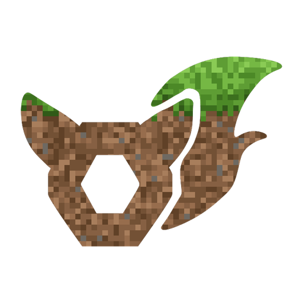
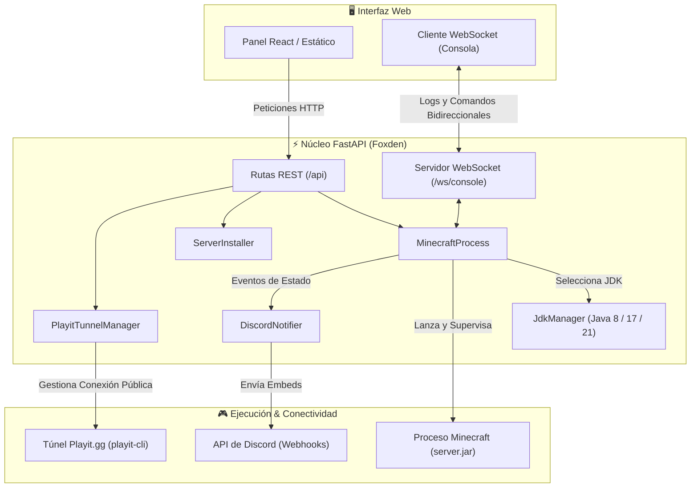

<div align="center">
  
</div>

---

# Foxden 🦊

- **Autor**: [AnthoFu 🦊](https://github.com/AnthoFu)
- **Última actualización del README**: `22/11/2026`

Este repositorio contiene todo el código y las funciones de **Foxden**. Es un panel de control web moderno, ligero y autónomo para crear, administrar y jugar en servidores de Minecraft (**Vanilla, Paper, Purpur, Fabric y Forge**) sin necesidad de pagar hosting ni lidiar con configuraciones complejas de red.

---

## ✨ Características

Foxden está diseñado para gestionar servidores de Minecraft de forma autónoma tanto en local como en la nube (GitHub Codespaces o VPS):

- **🎮 Soporte Multi-Motor:** Descarga e instalación autónoma de Vanilla, Paper, Purpur, Fabric y Forge con catálogo de versiones actualizado en un clic.
- **☕ Detección Inteligente de Java (JDK):** Identifica las versiones de Java instaladas en el sistema y selecciona automáticamente la versión adecuada (JDK 8, 17 o 21) según la versión de Minecraft elegida.
- **🌐 Conexión Pública sin Abrir Puertos:** Integración nativa con **Playit.gg** para generar túneles TCP seguros y jugar con amigos desde cualquier lugar sin tocar el router.
- **📊 Monitoreo y Consola Interactiva:** Métricas en vivo (CPU, memoria RAM, tiempo de actividad) y terminal interactiva bidireccional vía **WebSockets**.
- **🔔 Notificaciones en Discord:** Webhooks automáticos con mensajes enriquecidos (embeds) al iniciar, apagar o ante caídas inesperadas del servidor.
- **🎨 Panel Web Reactivo:** Interfaz moderna construida en **React**, **TypeScript** y **Tailwind CSS**, con fallback estático incluido.

---

## 📊 Diagrama de Arquitectura y Flujo

Este diagrama muestra cómo interactúa el panel web con el backend FastAPI, los procesos del servidor Minecraft y los servicios externos:



---

## 📂 Estructura del Repositorio

El proyecto está organizado de forma modular separando el backend en Python del frontend en React:

```
.
├── 📄 run.py                   # Script de lanzamiento y orquestación del servidor
├── 📄 requirements.txt         # Dependencias de Python (FastAPI, Uvicorn, httpx, etc.)
├── 📄 foxden_settings.json     # Archivo de configuración persistente (RAM, JDK, Webhooks)
├── 📁 app/                     # Backend FastAPI
│   ├── 📄 main.py              # Punto de entrada de la aplicación web y rutas estáticas
│   ├── 📄 version.py           # Fuente única de la verdad (lee version.json)
│   ├── 📁 api/                 # Controladores de rutas REST y WebSockets
│   │   ├── 📄 routes.py        # Endpoints de estado, configuración e instalador
│   │   └── 📄 websocket.py     # Transmisión en vivo de consola y comandos
│   ├── 📁 core/                # Módulos del núcleo del sistema
│   │   ├── 📄 config.py        # Gestor de server.properties de Minecraft
│   │   ├── 📄 discord.py       # Notificaciones y embeds de Discord Webhook
│   │   ├── 📄 installer.py     # Descargador e instalador de motores de Minecraft
│   │   ├── 📄 jdk.py           # Detección y emparejamiento de versiones de Java
│   │   ├── 📄 process.py       # Control de procesos y métricas del servidor
│   │   ├── 📄 settings.py      # Persistencia de ajustes del panel
│   │   └── 📄 tunnel.py        # Integración con el túnel Playit.gg
│   └── 📁 static/              # Interfaz de respaldo estática, logos y estilos
├── 📁 frontend/                # Frontend moderno SPA (React + TypeScript + Vite)
│   ├── 📁 src/                 # Componentes, pestañas, hooks y servicios
│   ├── 📁 public/              # Logos y favicons
│   ├── 📁 dist/                # Bundle compilado de producción servido por FastAPI
│   ├── 📄 package.json         # Dependencias y scripts de Node.js
│   └── 📄 vite.config.ts       # Configuración de Vite
└── 📁 servidor_minecraft/      # Espacio aislado de ejecución del servidor Minecraft
    ├── 📁 mods/                # Carpeta para colocar mods (.jar) de Forge/Fabric
    └── 📄 server.properties    # Configuración del servidor de Minecraft
```

---

## 🚀 Cómo Empezar

### 1. Requisitos

- [Python](https://www.python.org/) (v3.10 o superior)
- [Java / JDK](https://adoptium.net/) (JDK 8, 17 o 21 según la versión de Minecraft a jugar)
- [Node.js](https://nodejs.org/) (v18 o superior — *opcional, solo requerido para desarrollo del frontend*)

### 2. Instalación

Clona el repositorio e instala las dependencias en un entorno virtual aislado:

```bash
git clone https://github.com/AnthoFu/foxden.git
cd foxden

# Crear y activar entorno virtual
python3 -m venv .venv
source .venv/bin/activate

# Instalar dependencias
pip install -r requirements.txt
```

### 3. Ejecución

Para iniciar el servidor FastAPI y el panel web:

```bash
python run.py
```

Foxden se iniciará automáticamente en:  
👉 **http://localhost:8000** (o la URL asignada automáticamente en GitHub Codespaces).

---

## 🌐 Conexión Pública (Jugar con Amigos)

Para que cualquier persona pueda conectarse desde cualquier lugar sin abrir puertos en el router:

1. Ve a la pestaña **Conexión Pública (Playit)** en el panel.
2. Haz clic en **Iniciar Túnel**.
3. Vincula tu cuenta gratuita de [playit.gg](https://playit.gg) la primera vez y copia la dirección asignada (ejemplo: `tu-servidor.craft.playit.gg`).
4. ¡Pásale esa dirección a tus amigos para que se conecten desde **Minecraft > Multijugador > Conexión Directa**!

---

## 🔔 Notificaciones en Discord

Para recibir avisos automáticos en tu canal de Discord cuando el servidor encienda o se detenga:

1. En Discord, ve a **Ajustes del Canal** ➔ **Integraciones** ➔ **Webhooks** y crea uno nuevo.
2. Copia la URL del webhook y pégala en la pestaña **Configuración** de Foxden.
3. Haz clic en **Probar Webhook** para validar la conexión.

---

## 🛠️ Desarrollo del Frontend (Opcional)

Si deseas realizar modificaciones en la interfaz de React:

```bash
cd frontend
npm install
npm run dev
```

Para recompilar el bundle final de producción listo para FastAPI:

```bash
npm run build
```
